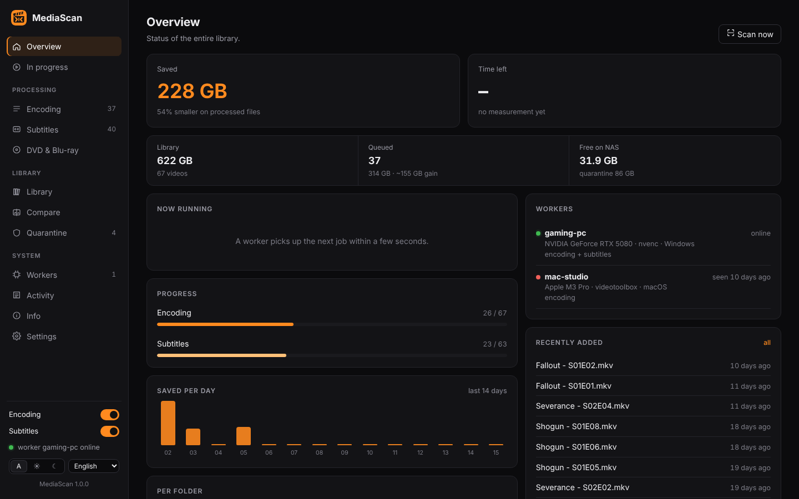
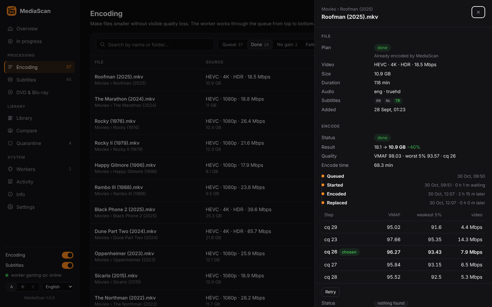
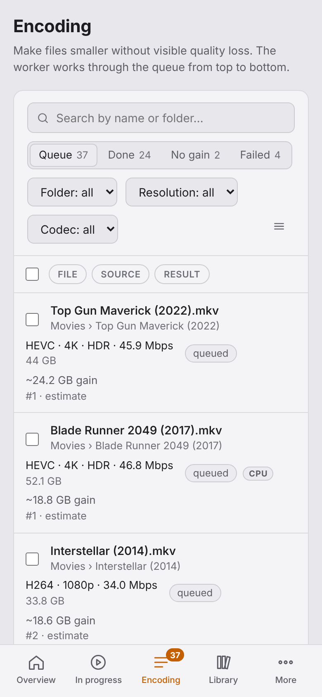

# MediaScan

[](https://github.com/Thepromo01/mediascan/releases)
[](https://github.com/Thepromo01/mediascan/pkgs/container/mediascan)
[](https://github.com/Thepromo01/mediascan/actions/workflows/checks.yml)
[](LICENSE.md)

**Make your movie and TV library smaller without visible quality loss, and fill in missing subtitles.**

MediaScan re-encodes each title to HEVC (10-bit) and checks the result with
[VMAF](https://github.com/Netflix/vmaf), the perceptual quality score Netflix uses. It replaces a file
only when the new version passes, and it keeps the original in quarantine for a while so you can
always go back. It also looks for missing subtitles on OpenSubtitles. If it can't find them, it
makes them on your own hardware with Whisper (speech recognition) and a local language model.

It is built for home servers. You run a dashboard on your NAS and one or more *workers* on PCs or
Macs with a decent graphics card.

> Typical results: a 26 GB 1080p Blu-ray remux becomes 8–9 GB, and a 21 GB file becomes about 6 GB,
> with no difference you can see on a TV. Most libraries shrink by 40–60%.

## A look at the dashboard

<table>
<tr>
<td width="63%" valign="top">
<br><br>

</td>
<td width="37%" valign="top">

</td>
</tr>
<tr>
<td align="center"><sub>Overview and file details</sub></td>
<td align="center"><sub>On a phone</sub></td>
</tr>
</table>

The dashboard works just as well on a phone: lists become cards, the main pages sit in a tab bar, and
the theme follows your system (or pick light or dark). Every page explains itself: a status chip tells
you what it means when you hover, a failed job comes with a plain-language explanation and the next
step, and the Info page rates your hardware and holds a knowledge base.

---

## Features

- **Quality-checked encoding.** Each title is measured with VMAF in two stages. First, short
  samples are tested to find the most efficient setting. Then the whole film is checked against
  your quality target (the average score and the worst 5% of frames). A title that misses the
  target, or would save too little space, keeps its original.
- **A bitrate floor.** You set a minimum bitrate (default 5 Mbps for 1080p), and 4K, 720p, HDR and
  animation scale from it. Grain and dark scenes stay clean.
- **Grainy films on the CPU.** Some films carry so much film grain that a GPU encoder cannot shrink
  them without losing the target. Those can go to a second slot that runs x265 with grain tuning on
  the worker's CPU, next to the GPU work, by hand or automatically. The CPU encoder gets all cores
  but two and a lower priority, so the machine stays responsive.
- **Honest measurements.** The whole-film check pairs frames by number, re-measures a result that
  does not fit the samples, and never calls a measuring error a quality verdict. Files that cannot
  gain (already efficient HEVC, or needing more bits than the source) are skipped before hours are
  spent on them.
- **Nothing is lost.** Workers never touch your originals. A new file goes to a staging folder, and
  the server checks it again (duration, tracks) before swapping. Replaced originals stay in
  quarantine (7 days by default) and can be restored or re-encoded with one click. Audio, subtitles,
  chapters and HDR metadata are copied 1:1.
- **Plex-aware.** With Plex connected, a movie isn't replaced while someone is watching it, and Plex
  refreshes after every change.
- **Subtitles in 38 languages.** MediaScan fills in the languages you choose. It searches
  OpenSubtitles, checks the timing and syncs it if needed. If nothing is found, it transcribes the
  audio with Whisper and translates with [Ollama](https://ollama.com), all on your own machine.
- **DVD and Blu-ray folders** (`VIDEO_TS` / `BDMV`) are turned into a single `.mkv` on request.
  Dolby Vision profile 7 discs are converted to profile 8.1, so Plex and most TVs can play them.
- **Compare.** Four frames of the original and the new version, chosen by content (the busiest and the
  darkest scene plus two fixed points), with a wipe slider, a flip mode and an enlarged view, next to
  the measured scores. Comparisons can be made automatically for every replaced film, with a storage cap.
- **Many workers.** NVIDIA (NVENC), Intel (QSV/VA-API), AMD (AMF/VA-API), Apple Silicon
  (VideoToolbox), or CPU (x265). Workers update themselves when the server has a new version.
- **Know your hardware.** The Info page shows every worker's CPU, GPU, VRAM and memory, rates them
  for GPU encoding, CPU encoding, Whisper and the translation model (Low to Ultra), lists the tools
  in use with versions, and explains every setting in plain language.
- **Clear about what is happening.** *In progress* says why nothing runs (no worker, paused, empty
  queue) and what to press; running jobs show their step and the time left; queued films show their
  position and expected start; the activity log reads like a diary with filters and search.
- **Easy to use.** A setup wizard walks you through the first run. Every list sorts by column, filters
  by folder, resolution and codec, pages at 50/100/200 rows and has a compact mode; `/` jumps to the
  search box and `?` lists the shortcuts. The dashboard comes in 38 languages, with light and dark
  themes, and works on a phone with a bottom tab bar. A small Windows app shows what the worker is
  doing.
- **Secure by default.** It requires a password plus two-factor authentication (TOTP). Logins are
  rate-limited, requests are CSRF-protected, and a Content Security Policy blocks every external resource. The
  container runs as a non-root user with pinned dependencies.

## How it works

```
             ┌─────────────────────────── your network ───────────────────────────┐
             │                                                                     │
  browser ──▶│  MediaScan server (Docker on your NAS)        Workers (PC / Mac)    │
             │  • scans the library, plans the work   ◀───▶  • encode + VMAF        │
             │  • dashboard + API on :8780            jobs   • subtitles (Whisper,  │
             │  • checks and swaps files, quarantine          Ollama, OpenSubtitles)│
             │              │                                       │               │
             │              └──────────── media share (SMB/NFS) ────┘               │
             └─────────────────────────────────────────────────────────────────────┘
```

The server only does light work (scanning, planning, final checks), so 1 GB of RAM is plenty. The
heavy work happens on the workers, which read from and write to the same media share.

## Quick start

### 1. Server (Docker)

You need Docker on a NAS or server: Synology DSM 7.2+ (Container Manager), Unraid, TrueNAS,
Portainer, or plain Linux with Docker Compose.

1. Create a folder for MediaScan, for example `/volume1/docker/mediascan`, and save
   [`docker-compose.yml`](docker-compose.yml) in it.
2. Edit the two marked lines: your media folder, and the `PUID`/`PGID` of a user that can write to it.
3. Start it:
   - **Synology:** Container Manager › Project › Create › choose the folder › use the existing
     `docker-compose.yml` › Done.
   - **Anywhere else:** `docker compose up -d`
4. Open `http://<your-server>:8780`. The first time, you set a password using the **setup code**
   from the container log (`docker logs mediascan`, or Container Manager › Container › mediascan ›
   Log). Then you set up two-factor authentication.
5. The setup wizard covers the language, folders to skip, subtitle languages, the quality level and
   Plex. The first library scan starts automatically.

More detail, including Unraid, reverse proxies and backups, is in
[docs/install-server.md](docs/install-server.md).

### 2. Worker (Windows, macOS or Linux)

In the dashboard, go to **Workers › Add worker**. Download the package for your system (it already
contains the dashboard address and the worker key) and run the installer:

| System | Run | What it sets up |
|---|---|---|
| Windows 10/11 | `Install-Worker.bat` | Python, ffmpeg with VMAF, the worker, a tray icon and the MediaScan app |
| macOS 13+ (Apple Silicon) | `bash install.sh` | Homebrew packages, the worker as a launchd service |
| Linux (x86-64) | `bash install.sh` | ffmpeg with VMAF, the worker as a systemd user service |

The installer tests the connection, finds the media share by itself and asks at most one question:
whether to set up subtitles (Whisper + Ollama). The worker appears in the dashboard within a minute.
On Windows, everything else can be changed later in the MediaScan app (Settings). Details:
[docs/install-worker.md](docs/install-worker.md).

### 3. Go

Encoding and subtitles start **switched off**. Pick a few titles in the Encoding queue and choose
**Process only these** to see the results, then switch both on in the sidebar.

## Updating

The server image is rebuilt on every push to `main` (`:edge`) and for every version tag (`:latest`,
`:1.0`). Update it with `docker compose pull && docker compose up -d` (on Synology: Container Manager ›
Project › Action › Build or the Images page). Workers update themselves: they check the server every
10 minutes and install new files after their current job, so there is nothing to do on the PC.

## Requirements

| | Minimum | Recommended |
|---|---|---|
| **Server** | Docker, 1 CPU core, 1 GB RAM | — |
| **Worker (Windows/Linux)** | 4 cores, 8 GB RAM, 100 GB free SSD, GPU: NVIDIA GTX 1660 Super / RTX 2060, Intel Arc or 11th-gen iGPU, AMD RX 6000 | NVIDIA RTX 3000 or newer, 16 GB RAM, 250 GB free |
| **Worker (macOS)** | Apple Silicon M1, macOS 13, 16 GB RAM, 150 GB free | M2 Pro / M3 or newer, 24–32 GB |
| **Subtitles** | NVIDIA with 8 GB VRAM, or a Mac with 24 GB | NVIDIA with 12–16 GB |
| **Network** | Gigabit, wired | — |

Without a supported GPU the worker falls back to x265 on the CPU, which works but is much slower.
The dashboard's **Info** page rates your actual hardware against these recommendations.

## Documentation

- [Installing the server](docs/install-server.md): Docker, Synology, Unraid, reverse proxy, updating, backup
- [Installing workers](docs/install-worker.md): Windows, macOS, Linux, worker settings
- [Using MediaScan](docs/usage.md): the dashboard, quality settings, quarantine, subtitles, discs
- [Configuration](docs/configuration.md): environment variables and all settings
- [Troubleshooting and FAQ](docs/troubleshooting.md)
- [Security](SECURITY.md) · [Changelog](CHANGELOG.md) · [Contributing and translations](CONTRIBUTING.md)

## Security in short

MediaScan is meant for your **own network**. Don't forward port 8780 in your router; to reach it
from outside, use a VPN such as Tailscale or WireGuard. Logins need a password and a TOTP code, and
repeated failures cause a pause. The worker key only allows worker actions. Keep it secret, and you
can renew it on the Workers page. See [SECURITY.md](SECURITY.md) for the full model and how to report
a vulnerability.

## License

MediaScan is **source-available** under the [PolyForm Noncommercial License 1.0.0](LICENSE.md).
You may use, change and share it for any noncommercial purpose: at home, for a hobby, or in
education, research or a charity. **You may not use it to make money.** That rules out selling it,
offering it as a paid service, or bundling it into a commercial product. Because of that
restriction, this is not an OSI "open source" licence.

MediaScan builds on excellent free software: FFmpeg, libvmaf, x265, MKVToolNix, dovi_tool,
faster-whisper, ffsubsync, Ollama, FastAPI and the Inter typeface (SIL Open Font License). Those
projects keep their own licences. The worker installers download them from their official sources.
